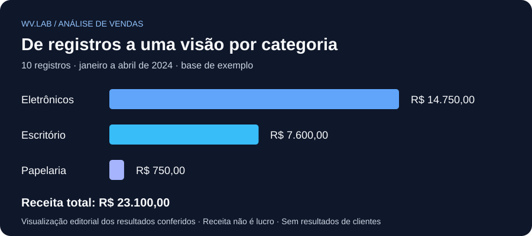

# Análise de vendas com Python

**Como transformar uma tabela de vendas em uma visão de receita por categoria?**

Estudo de portfólio de [Wandley Vitor · WV.LAB](https://github.com/wandleyvitor), com Pandas e Matplotlib. O projeto lê um CSV, calcula a receita de cada registro e apresenta a soma por categoria em um gráfico.

## O que este projeto demonstra

- Leitura de dados tabulares e conversão de datas com Pandas.
- Cálculo de receita: quantidade × preço unitário.
- Agrupamento dos valores por categoria.
- Visualização e interpretação de um resumo de vendas.

Em um negócio, esse tipo de resumo pode apoiar a conferência de vendas. Aqui, os dados são uma **base pequena de exemplo**, apresentada no portfólio como fictícia; não representam receita de cliente nem resultados comerciais comprovados.

## Resultados da base incluída

| Categoria | Receita | Participação aproximada |
|---|---:|---:|
| Eletrônicos | R$ 14.750,00 | 63,85% |
| Escritório | R$ 7.600,00 | 32,90% |
| Papelaria | R$ 750,00 | 3,25% |
| **Total** | **R$ 23.100,00** | **100%** |

São **10 registros e 98 unidades**, entre 5 de janeiro e 10 de abril de 2024. Um registro não identifica necessariamente um pedido independente; a base não tem identificador de pedido.

**Leitura:** Eletrônicos concentra a maior receita desta amostra. Isso não permite concluir qual categoria dá mais lucro ou qual decisão de estoque seria ideal: faltam custos, margens, disponibilidade e uma base mais representativa.

A ilustração acima resume os resultados para leitura no GitHub. O script original gera seu próprio gráfico de barras no Matplotlib.

## Como executar

Requisitos: Python, Pandas e Matplotlib. Baixe ou clone o repositório e abra o terminal na pasta que contém o script e o CSV.

No Windows / PowerShell:

~~~powershell
python -m venv .venv
.\.venv\Scripts\python.exe -m pip install -r requirements.txt
.\.venv\Scripts\python.exe analise_vendas.py
~~~

Não é necessário ativar o ambiente virtual ou alterar a política de execução do PowerShell.

O terminal mostra a tabela com a coluna de receita e uma janela exibe o gráfico. Execute em um ambiente local com interface gráfica; servidores sem tela precisam salvar a figura em arquivo.

## Arquivos

| Arquivo | Finalidade |
|---|---|
| [analise_vendas.py](analise_vendas.py) | Leitura, cálculo, agrupamento e gráfico. |
| [vendas.csv](vendas.csv) | Dez registros de exemplo usados pelo script. |
| [requirements.txt](requirements.txt) | Versões das bibliotecas usadas na conferência. |
| [docs/receita-categoria.svg](docs/receita-categoria.svg) | Resumo visual estático dos resultados. |

O CSV usa vírgula como separador e as colunas data, produto, categoria, quantidade, preco_unitario e regiao.

## Conferência e limites

Em **8 de novembro de 2026**, o script existente foi executado com Python 3.14.2, Pandas 3.0.0 e Matplotlib 3.10.8. Os totais por categoria foram comparados a uma soma independente com aritmética decimal e coincidiram. O gráfico foi gerado com renderização sem janela; a abertura da janela interativa não foi testada nessa execução.

O código e a base encontrados no repositório foram preservados. Esta organização acrescentou documentação, dependências e apresentação visual com assistência de IA; **não é uma recuperação comprovada de arquivos anteriormente perdidos**.

O projeto é introdutório: não faz limpeza completa de dados, validação de entradas, ajuste por devoluções, persistência, integração ou cálculo de lucro. O cálculo original usa os tipos numéricos do Pandas; esta base contém preços inteiros. Uma aplicação com valores fracionários exige definir arredondamento e representação monetária.

## Autoria e contato

Projeto de estudo de Wandley Vitor. A apresentação atual foi organizada com assistência de IA. É uma demonstração de aprendizagem, sem atribuir experiência com clientes ao estudo.

[Conheça outros projetos e entre em contato](https://github.com/wandleyvitor).
